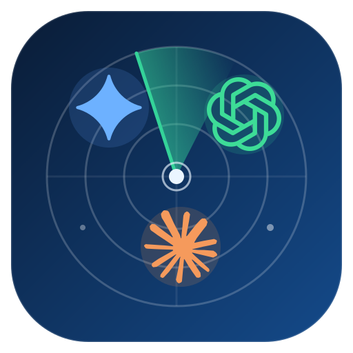

<p align="center">
  
</p>

# ResetRadar

御三家模型额度重置追踪面板的 React + TypeScript 前端示例。

> 品牌标志为蓝色雷达屏：同心扫描环与右上扫描扇区象征实时监测，屏上的白、绿、黄三个光点分别代表被追踪的御三家厂商。源文件为 `public/logo.svg`，另有 `public/favicon.svg`、`public/favicon.ico` 与多尺寸 PNG 图标供浏览器标签页和移动端主屏幕使用。

## 环境要求

- Node.js 20.19+ 或 22.12+
- npm

## 启动开发环境

```bash
npm install
npm run dev
```

浏览器打开终端输出的地址，通常是 http://localhost:5173。

## 构建生产版本

```bash
npm run build
npm run preview
```

生产静态文件输出到 `dist/`，可部署到 Nginx 等静态 Web 服务器。

## 数据说明

- 页面数据来自 `src/data/` 下的 JSON 文件（相当于轻量数据库）：`posts.json`（帖子，只保留最近 100 条，每条带作者头像）、`people.json`（监听人物与头像）、`history.json`（重置历史）、`status.json`（御三家当前重置概率、判断依据与一句话总结）。
- 数据由 Muse 每 12 小时自动拉取一次：来源为御三家官方账号、代言人/核心成员的公开帖子（经 X 镜像站核对），以及网络上相关的重置传闻（传闻会标注为待核验）。
- 每次拉取后，Muse 重新判断各家的 24h 重置概率与重置来源，更新 JSON 后以 Muse 的名义提交推送；推送后由既有部署流水线自动构建上线（resetradar.aikio.blog），无需人工操作。
- 概率为基于公开信息的社区估算，不构成官方承诺；帖子均保留来源链接与核验状态。
- 主题偏好保存在浏览器 localStorage。
- 时间统一按 Asia/Shanghai（北京时间，UTC+8）显示。

## 项目结构

```text
reset-radar/
├── index.html
├── package.json
├── vite.config.ts
├── tsconfig.json
├── tsconfig.node.json
├── public/
│   ├── logo.svg / logo-192.png / logo-512.png
│   ├── favicon.svg / favicon.ico / favicon-32.png
│   ├── apple-touch-icon.png
│   └── site.webmanifest
└── src/
    ├── App.tsx
    ├── main.tsx
    ├── index.css
    └── data/
        ├── posts.json
        ├── people.json
        ├── history.json
        └── status.json
```
