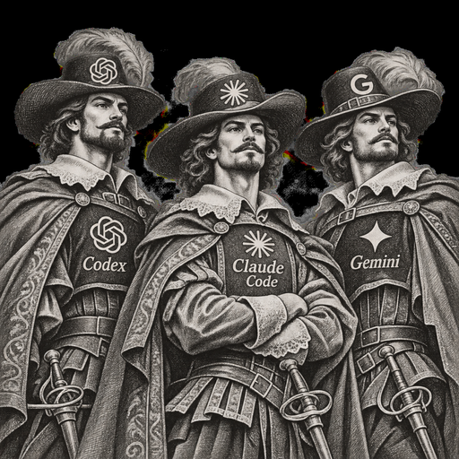

  

# ResetRadar

**御三家 AI 额度重置追踪站** —— 盯着 OpenAI、Google、Anthropic 三家的订阅额度什么时候重置，不用再自己满世界刷消息。

在线访问：https://resetradar.aikio.blog

## 这个项目可以做什么

- **今日雷达总览**：打开首页就能看到三家未来 24 小时的重置概率、判断依据和一句话总结，哪家最可能重置一目了然。
- **官方动态流**：汇总三家官方账号和核心人物（Sam Altman、Demis Hassabis、Sundar Pichai、Tibo、Varun Mohan、Boris Cherny 等）的最新公开动态，可按厂商筛选；真正的重置帖子会单独标出公布时间、生效时间和重置说明。
- **重置日历**：近两个月的真实重置记录都在日历上，点任意一天就能看到当天哪家重置过、因为什么重置，方便摸清各家的重置节奏。
- **概率研判**：每次重置的可能性不是瞎猜，而是结合各家近期的重置频率、官方表态和相关传闻综合判断，并写明依据。
- **一键快讯**：可以把三家的概率和最新动态一键复制成一段文字，直接转发到群里或社交平台分享。
- **随时看**：支持深色 / 浅色主题，手机和电脑上都能用。

## 数据说明

- 数据由 Muse 每小时自动更新一次，来源是三家官方账号与核心人物的公开帖子，每条都核对过原文并附来源链接；未经证实的传闻会明确标注「待核验」，不会当成事实。
- 重置概率是基于公开信息的社区估算，不构成官方承诺，请结合自己的订阅情况判断。
- 页面上的时间均为北京时间（UTC+8）。

---

站内厂商图标来自 [Lobe Icons](https://github.com/lobehub/lobe-icons)（MIT）；项目 Logo 为「御三家 · 三个火枪手」主题图：Codex、Claude Code 与 Gemini 化身三位佩剑火枪手。
